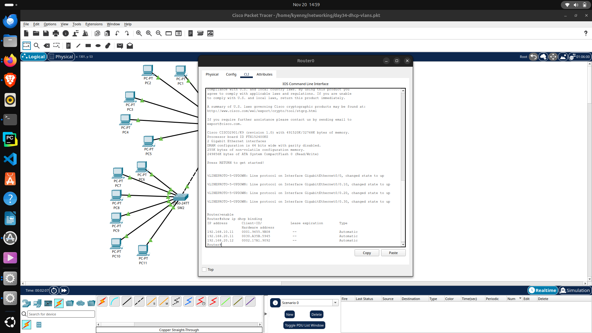
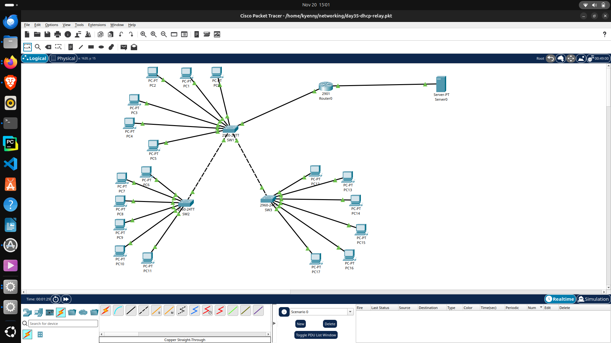
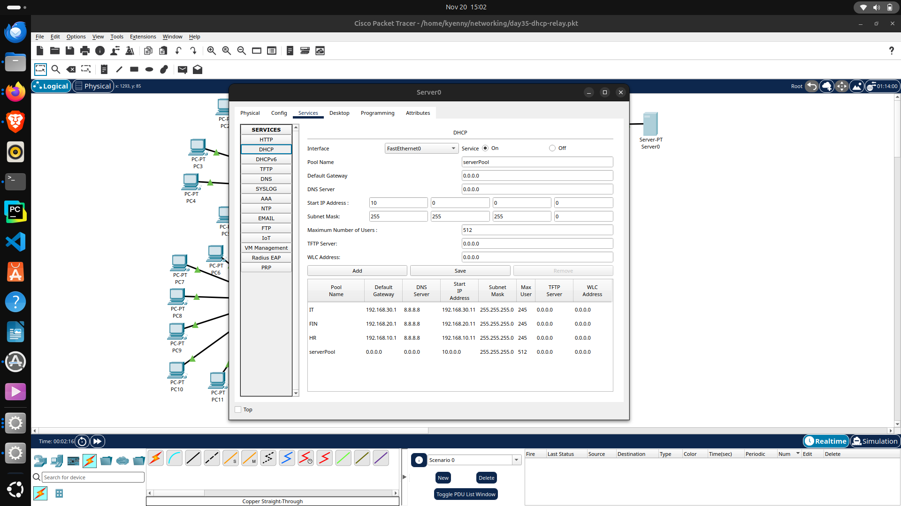
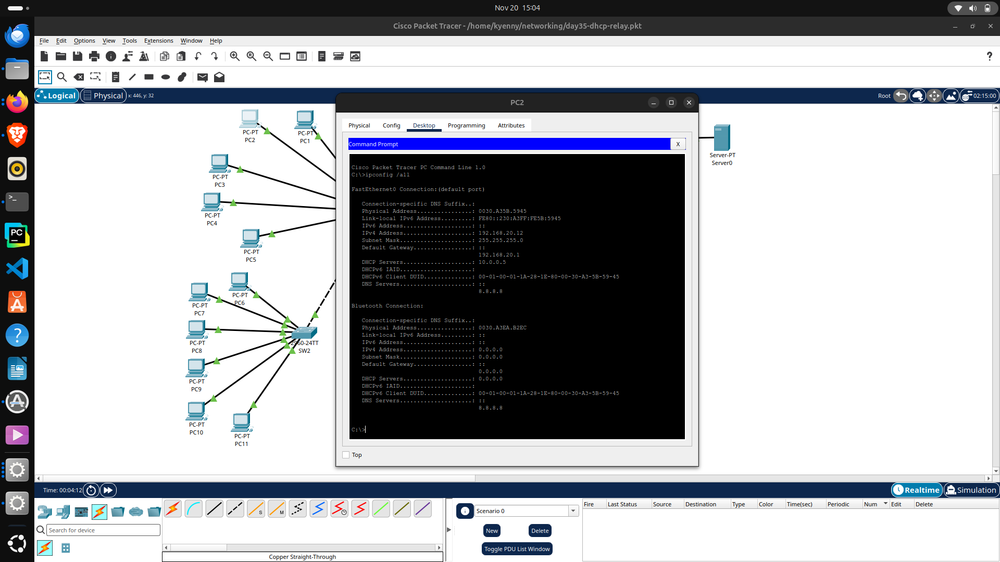
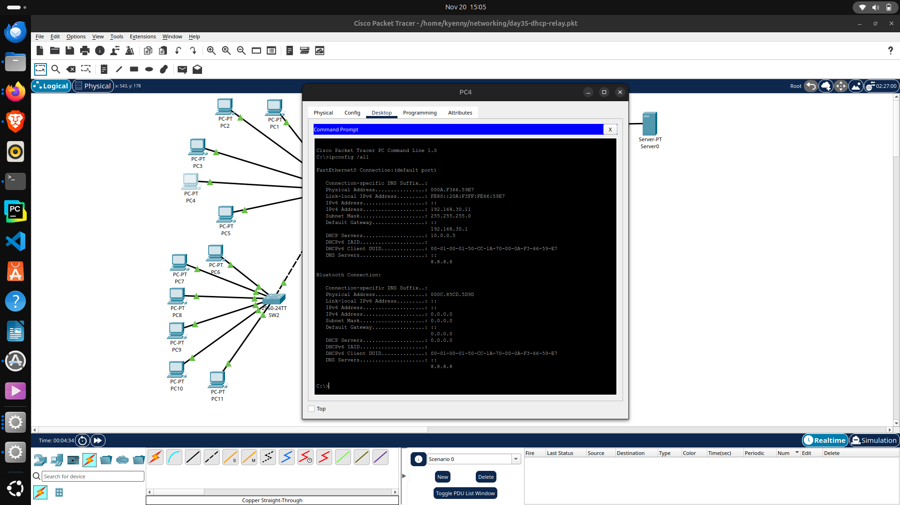
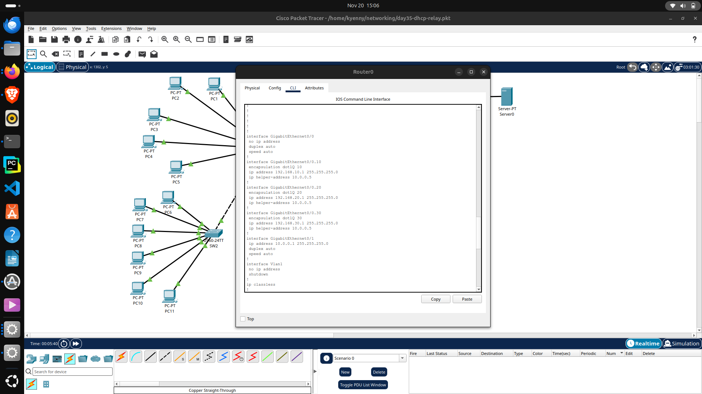

# DHCP for a Multi-VLAN Network: Router as Server, then a Relay to a Separate Server

## Overview

A Cisco Packet Tracer lab on DHCP (Dynamic Host Configuration Protocol). I started with a router handing out addresses on one small LAN, then gave an 18-PC, three-VLAN network its addresses from three pools on the router, and finally moved the DHCP server onto a separate network, using the router as a relay with `ip helper-address`.

## Problem / Scenario

Typing an address, mask, gateway, and DNS server into every PC doesn't scale, and it's easy to get wrong. I wanted PCs to get their settings automatically, one pool per VLAN, and I wanted to see what changes when the DHCP server is not on the same network as the clients, because a router doesn't forward the broadcast that starts a DHCP request.

## Objectives

- Configure a router as a DHCP server and watch PCs receive their settings
- Give each VLAN its own pool, with its own gateway
- Move the server to a separate network and make DHCP work through a relay
- Prove from the PCs which server actually answered

## Network Architecture

**Stage 1: one LAN.** One router (R1), one switch, three PCs, network `192.168.50.0/24`. The router's LAN port is `192.168.50.1`.

**Stage 2: three VLANs on three switches.** Router-on-a-stick, 18 PCs (six per switch), three switches joined by trunks, with the VLANs created on every switch. The router serves all three VLANs from three pools.

| VLAN | Pool | Network | Gateway | Excluded |
|---|---|---|---|---|
| 10 | HR | 192.168.10.0/24 | 192.168.10.1 | .1 to .10 |
| 20 | FIN | 192.168.20.0/24 | 192.168.20.1 | .1 to .10 |
| 30 | IT | 192.168.30.0/24 | 192.168.30.1 | .1 to .10 |

**Stage 3: a separate DHCP server.** A server on `10.0.0.0/24` attached to the router's second port. The router's port is `10.0.0.1` and the server is `10.0.0.5`, with `10.0.0.1` as its default gateway. The router no longer serves DHCP itself, and relays instead.

## Technologies & Tools

Cisco Packet Tracer, a 2901 router, 2960 switches, the Packet Tracer server's DHCP service, 802.1Q subinterfaces, Cisco IOS CLI.

## Files in this folder

| File | What it is |
|---|---|
| `configs/day34-dhcp-vlans.pkt` | the 18-PC network with the router as the DHCP server |
| `configs/day35-dhcp-relay.pkt` | the same network with a separate DHCP server and a relay |

## Implementation

**Stage 1.** I excluded the router's own address and the next few (`.1` to `.10`), made one pool, and set the PCs to DHCP.

**Stage 2.** One pool for each VLAN. Each pool's network matches its VLAN's subnet, and each pool's default router is the router's address inside that subnet. A PC can only reach a gateway in its own subnet, so a pool that hands out the wrong gateway breaks that VLAN.

**Stage 3.** A router doesn't forward broadcasts, so a Discover from a PC on a different network would stop at the router. I removed the router's own pools and added `ip helper-address 10.0.0.5` to each VLAN's subinterface. The router then forwards each Discover to the server as a unicast and writes its own address on the client side into the request (the giaddr field), so the server knows which pool to answer from. The command goes on the interface the clients are connected to, because that's where the broadcast arrives.

## Configuration

**Router as the DHCP server (one VLAN shown; the other two follow the same pattern)**

```
ip dhcp excluded-address 192.168.10.1 192.168.10.10
ip dhcp pool HR
 network 192.168.10.0 255.255.255.0
 default-router 192.168.10.1
 dns-server 8.8.8.8
```

**Router as a relay**

```
interface gigabitEthernet 0/1
 ip address 10.0.0.1 255.255.255.0
 no shutdown
interface gigabitEthernet 0/0.10
 ip helper-address 10.0.0.5
```

The same helper line goes under `Gig0/0.20` and `Gig0/0.30`.

**Server pools (on the Packet Tracer server's DHCP page):** HR, FIN, and IT, each with its own default gateway (`.10.1`, `.20.1`, `.30.1`), DNS `8.8.8.8`, start address `.11`, and mask `255.255.255.0`.

## Testing & Validation

| Test | Result |
|---|---|
| Stage 1: three PCs on DHCP | received `.11`, `.12`, `.13` in order |
| Stage 1: `show ip dhcp binding` | three rows, one per PC, each with its MAC address |
| Stage 1: `ipconfig /all` | address, mask, gateway `192.168.50.1`, DHCP server `192.168.50.1`, DNS `8.8.8.8` |
| Stage 2: 18 PCs on DHCP | 18 bindings: `.11` to `.16` in each of the three subnets |
| Stage 2: same VLAN, across switches | success, TTL 128 |
| Stage 2: different VLANs | success, TTL 127 |
| Stage 3: one PC per VLAN, `ipconfig /all` | correct address and gateway for each VLAN, and **`DHCP Servers: 10.0.0.5`** on all three |
| Stage 3: HR to Finance | success, TTL 127, the first ping timing out |

The `DHCP Servers: 10.0.0.5` line is the proof that the relay works, because it shows the server answered, not the router.

## Troubleshooting

**The IT pool had the wrong gateway.** When I reviewed the server's DHCP page before testing, the IT pool's default gateway read `192.168.30.11`, the same as its start address, instead of the router's `192.168.30.1`. IT PCs would have been told to send outside traffic to a PC. I changed it to `192.168.30.1` and saved the pool. Verification: `ipconfig /all` on an IT PC showed gateway `192.168.30.1`.

## Observations about Packet Tracer

- The lease column in `show ip dhcp binding` shows `--`, and the `lease 7` command was rejected with "Invalid input". It looks like Packet Tracer simplifies lease handling. I haven't confirmed that.
- Pool addresses are handed out in order, starting from the lowest address that isn't excluded.

## Security Considerations

- A DHCP client trusts whoever answers first. A rogue DHCP server could hand out a bad gateway or DNS server to every client.
- DHCP starvation: an attacker asks for every address in a pool until none are left.
- The defense I'll build later is DHCP snooping, where a switch only accepts DHCP server replies from trusted ports. I haven't built it yet.
- With one central DHCP server, a failure or an attack on it affects every VLAN.

## Results

PCs in all three VLANs get their address, mask, gateway, and DNS automatically. With the server on a separate network, the relay carries each request to it and brings the reply back. I confirmed which server answered from the PCs' own `ipconfig /all`.

## Screenshots / Evidence

**The router's binding table (Stage 2, router as the DHCP server)**



**Topology of the relay lab (Stage 3)**



**The server's DHCP pools**



**ipconfig /all on one PC in each VLAN, showing the server that answered**






**The relay lines on the router**



## What I Learned

- A DHCP request starts as a broadcast, because the client has no address and doesn't know the server.
- A router doesn't forward broadcasts, so a server on a different network needs a relay.
- `ip helper-address` goes on the client-facing interface, with the server's address inside the command.
- Each VLAN needs its own pool, and each pool's gateway has to sit inside its own subnet.
- Excluding the addresses of fixed devices keeps the server from handing them out.
- The server also needs a default gateway, because its replies go to the relay's address on the client side, which isn't on its own network.

## Challenges

The part that tripped me up was where `ip helper-address` goes. I first thought it belonged on the interface facing the server. It goes on the interface facing the clients, because that's where the broadcast arrives, and the server's address is what you type inside the command.

## Not Tested Yet

- Removing the helper-address from one VLAN's subinterface to watch that VLAN lose DHCP, then restoring it. I'd expect its PCs to show `0.0.0.0`, but I haven't run it.

## Improvements / Future Work

- Build DHCP snooping on the switches
- Run the missing-relay test above and document it
- Add DHCP reservations for fixed devices
- Add a second DHCP server so one failure doesn't take down every VLAN
- Add ACLs so VLANs can only reach what they need
